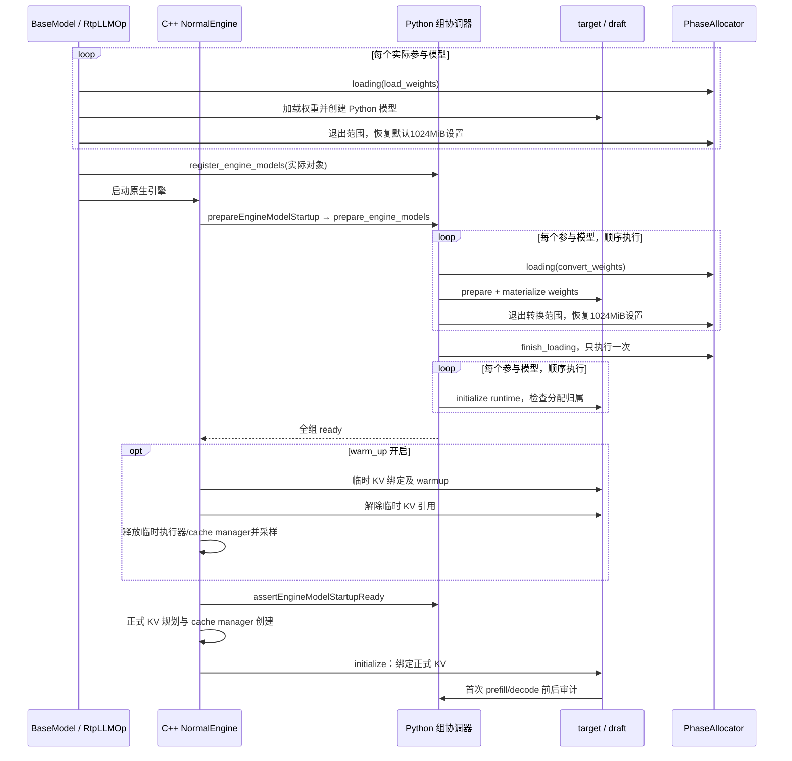
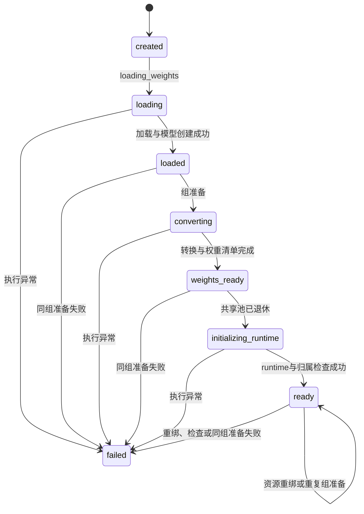

# DSV4 分阶段 CUDA 内存分配设计

本文描述当前 `feature/phase_allocator` 分支的实际实现，涵盖 Python 与 C++ 启动链路、普通 MTP target/draft、warmup 和 KV 规划。实现基准为 `8a7caa21c51cff4a74d7ac048f4b8f3c9d66b5c7` 及本分支的分阶段分配改动，必要依赖补丁为 `175460a4cf720a18a9882deb0d8c385c8e6b04ef`。功能默认关闭。

使用方法见 [DSV4 phase allocator](backend/phase_allocator.md)。本文侧重实现机制及约束，文末区分已验证行为与未认证范围。

## 1. 问题与目标

权重加载和转换会分配临时 Tensor、转换结果及长期驻留权重。使用 1024MiB 大页时，存活权重可能占据多个 segment 的部分空间，使剩余空间无法完整归还设备，压缩正式 KV cache 的可用预算。

本方案将启动内存分为两个分配域：权重准备采用 20MiB 策略，运行资源和推理采用 1024MiB 策略。引擎负责阶段顺序，模型负责在对应 hook 中创建资源。

必须保持以下不变量：

1. 所有参与模型的权重加载和转换完成后，才能退役共享加载池。
2. 运行资源、warmup 以及正式 KV 规划发生在加载池退役之后。
3. 推理阶段默认 native 分配域保持 1024MiB 设置，退休的加载域不能出现新增活跃块。
4. 权重 storage 地址、大小、形状和归属在转换完成后保持稳定。
5. 同一引擎的 target/draft 全部完成运行资源初始化后，才能发布组就绪并进入后续引擎启动。
6. 重复 `initialize` 只重绑资源，不重新转换权重或再次退休加载池。

这里的 20MiB/1024MiB 指当前 Torch 扩展的 `large_segment_size_mb` 分配策略，不是每个 Tensor 的大小，也不表示所有 CUDA 分配器、small pool 或外部通信库都采用该粒度。

## 2. 两个分配域与生命周期

| 资源 | 分配阶段 | native 分配域 | 存活周期 |
| --- | --- | --- | --- |
| checkpoint GPU 权重、转换中间量 | 加载、转换 | 私有 `pool_id`，20MiB | 临时量随引用释放；最终权重长期驻留 |
| 转换后的常驻权重及加载阶段保留的只读 Tensor | 转换 | 同一私有 `pool_id` | 跨越加载池退役，继续用于推理 |
| MegaMoE staging/output、共享运行 buffer、JIT 临时分配 | 运行资源初始化 | 默认 `(0, 0)`，1024MiB | 按运行资源自身生命周期管理 |
| warmup 临时 KV | 引擎 warmup | 默认域 | warmup 后解除引用并释放临时 owner |
| 正式 KV | 正式 cache manager 创建 | 默认域 | 服务运行期间 |
| Torch 快照不可见的通信/外部 CUDA storage | 由对应组件决定 | 记录为 external，不能证明其域或页大小 | 由外部组件管理 |

加载池“退役”是停止再向该域分配并回收可回收的空闲保留空间。存活权重仍属于原私有池，地址不迁移。后续推理访问这些权重，同时从默认 1024MiB 域分配运行内存。

仅动态改一次全局设置不能证明已有 segment 已改变粒度，因此实现同时使用独立池、分配路由和阶段门禁。启动时还要求默认 large 域为空，避免把历史页粒度未知的 segment 当作 1024MiB 域。

## 3. 组件职责

| 组件 | 实现位置 | 职责 |
| --- | --- | --- |
| `PhaseAllocator` | [phase_allocator.py](../rtp_llm/utils/phase_allocator.py) | 每进程共享私有池、native 全流路由、设置恢复、退休、storage 归属检查和快照 |
| `ModelStartupLifecycle` 与组协调函数 | [model_startup.py](../rtp_llm/utils/model_startup.py) | 单模型状态、参与者校验、全组转换/运行初始化、首次 forward 检查 |
| `BaseModel.load` | [base_model.py](../rtp_llm/models/base_model.py) | 将权重加载、WeightManager 和 Python 模型创建包在加载范围内 |
| `GptModelBase` | [module_base.py](../rtp_llm/models_py/model_desc/module_base.py) | 接入 initialize/forward、绑定 KV、提供 Tensor 清单及请求类型分类 |
| `DeepSeekV4Model` | [deepseek_v4_model.py](../rtp_llm/models_py/model_desc/deepseek_v4_model.py) | 拆分准备、权重 materialize、运行初始化，显式补充共享 buffer 清单 |
| `RtpLLMOp.start` | [rtp_llm_op.py](../rtp_llm/ops/rtp_llm/rtp_llm_op.py) | 注册实际 target/draft Python 对象身份 |
| `EngineModelStartup` | [EngineModelStartup.cc](../rtp_llm/cpp/normal_engine/EngineModelStartup.cc) | C++→Python 桥接、支持范围门禁、组准备、KV 前检查、warmup KV 解绑 |
| `NormalEngine` | [NormalEngine.cc](../rtp_llm/cpp/normal_engine/NormalEngine.cc) | 在临时/正式 KV 之前调用组准备，控制 warmup 和正式预算采样顺序 |
| MegaMoE / MegaMoE-SE executor | [mega_moe.py](../rtp_llm/models_py/modules/factory/fused_moe/impl/cuda/executors/mega_moe.py)、[mega_moe_se.py](../rtp_llm/models_py/modules/factory/fused_moe/impl/cuda/executors/mega_moe_se.py) | 将常驻权重转换与通信 buffer、output staging、JIT 预热分开 |

## 4. 完整启动时序



“全组”是单个进程内的实际参与模型集合。TP8 部署的各 rank 各自拥有进程内单例分配器和生命周期；这里没有新增一个跨所有 rank 的原子提交协议。分布式通信继续依赖原引擎及通信组件的调用顺序，AUTO 加载另有 WORLD 协商，见第 10 节。

### 4.1 加载与模型创建

`BaseModel.load` 在功能开启时先验证模型适配范围，获取共享 `PhaseAllocator`，为当前模型创建 `ModelStartupLifecycle`。`loading_weights()` 覆盖 `_load_and_create_python_model`，包括 `_load`、WeightManager 和 Python 模型构造；构造完成后将 lifecycle 挂到 `py_model._startup_lifecycle`。

模型加载范围退出时恢复 1024MiB 设置，但此时池仍处于可继续加载的状态。随后 draft 加载和 C++ 发起的转换会再次进入同一个私有池。不能在 target 的 `load` 返回时就退休它。

### 4.2 注册参与者与 C++ 阶段边界

`RtpLLMOp.start` 收集 target 与实际存在的 proposal model，注册 Python 对象身份。协调器拒绝重复对象、混合已接入/未接入模型、不同 allocator 以及与已注册集合不一致的参与者。

`NormalEngine` 构造过程中，在任何 warmup/cache manager 创建前调用 `prepareEngineModelStartup(params)`。桥接获取 GIL，使用与原 Python wrapper 相同的 `c10::InferenceMode`，传递真实角色、是否 speculative、最大 context batch 等上下文；第一次准备不携带 KV。

warmup 完成或被跳过后，C++ 再调用 `assertEngineModelStartupReady`，随后才执行 `initCacheManager` 和正式 `initExecutor`。因此 `warm_up=0` 同样具有阶段边界。注册过的模型若遇到缺少该桥接的旧原生库，不能通过普通 `initialize` 隐式提前退休 target 的池。

### 4.3 DSV4 的三个准备 hook

| Hook | 所在阶段 | 当前工作 |
| --- | --- | --- |
| `_prepare_startup(resources)` | 转换域 | 确定设备、role/speculative 信息及 MoE token 容量，使共享运行资源的容量在创建前确定 |
| `_materialize_startup_weights()` | 转换域 | 创建 V4Transformer 的 meta 结构并接管真实权重，完成 executor 权重布局、RoPE/压缩器只读 cache、MTP extra weights，释放旧 weight wrapper |
| `_initialize_startup_runtime()` | 默认运行域 | 初始化 MegaMoE runtime、运行侧 kernel/JIT 预热、共享 runtime buffers，最后标记 materialized |

MegaMoE 的 `setup_weights` 只完成权重部分；`_finish_weight_setup` 在 phase 模式下延迟调用 `initialize_runtime`。运行初始化要求 allocator 已进入 runtime，并使用 `_mega_runtime_ready` 保证幂等。MegaMoE-SE 复用该生命周期，分别实现其权重和 buffer 创建逻辑。

当前 phase runtime 要求能找到 `MegaMoeExecutor`，包括其 MegaMoE-SE 子类。没有该 executor 的后端会在转换后的运行初始化阶段报错；它是使用前提，不是已支持的替代路径。

## 5. 状态机与组就绪

单模型状态：



`ready` 表示当前模型运行初始化完成，`_engine_ready` 还表示所在组的所有模型均已完成准备。组准备流程为：

1. 要求所有参与模型均为 `loaded`。
2. 顺序将全部模型推进到 `weights_ready`。
3. 对共享 allocator 执行一次 `finish_loading()`。
4. 顺序完成全部模型的运行初始化。
5. 所有初始化成功后才设置各模型的 `_engine_ready` 并返回。

转换、退休或运行初始化的执行异常会将参与组模型置为 `failed`，清除组就绪并尝试关闭加载池。参数/参与者/状态不合法则直接拒绝进入准备流程。失败后不在同一引擎中重新加载权重，应退出并重新启动。

所有模型已 `ready` 且 `_engine_ready` 时，再次组准备只执行就绪/归属检查。普通 `initialize` 在 ready 状态只执行重绑前检查、`_bind_init_resources`、重绑后检查，并清空首次请求审计标记。

未注册引擎组的独立模型保留单模型初始化入口；正式引擎注册参与者后，必须先经过 C++ 组准备。

## 6. 私有池路由与设置恢复

`get_phase_allocator` 在每进程内复用一个 allocator，当前只支持一个 CUDA device。创建时验证 native allocator、所需私有 Torch API、`expandable_segments=True` 和 `large_segment_size_mb:1024`，并要求默认 large 域不存在历史 segment。

每次 `loading(stage)` 严格执行以下顺序：

```text
获取非阻塞锁，要求 allocator.state == loading，拒绝 Graph capture
同步当前设备
先 _cuda_beginAllocateToPool(device, pool_id)
再设置 large_segment_size_mb:20
执行加载或转换
finally:
    尝试同步设备
    先恢复保存的1024MiB完整设置
    再 _cuda_endAllocateToPool(device, pool_id)
    再 _cuda_releasePool(device, pool_id)
释放锁
```

先路由再切小页、先恢复大页再结束路由，避免切换窗口向默认域创建 20MiB segment。native all-stream route 覆盖加载生产线程和 C++ 回调，不只覆盖当前 Python 线程。范围结束时的 release 与最终退休不同：加载期间 allocator 持有 MemPool，可按顺序重新进入同一域。

`finish_loading()` 同步并释放 MemPool 句柄，执行 GC 和 `empty_cache`，记录仍存活的加载块集合，然后进入 `runtime` 状态。重复 finish 是幂等的；runtime 后再次进入 loading 会被拒绝。`empty_cache` 只释放可回收空间，不能强制释放仍被权重占用的页。

页设置与全流路由是进程级状态，代码采用非阻塞的 allocator 锁、单模型转换锁和引擎组准备锁，冲突时明确失败，不排队执行嵌套/并发加载。线程路由保证分配落入范围，但不会判断任意后台线程分配的业务用途。

清理过程中会尝试每个恢复步骤，保留原始异常，额外清理错误写日志。该处理不提供 CUDA 故障后的原进程继续服务保证。

## 7. warmup 与正式 KV 规划

阶段切换不依赖 warmup。C++ 先完成组准备，再决定是否 warmup，避免把首次权重转换藏在临时 KV 已经分配之后。

warmup 主要影响正式预算采样时有哪些对象仍占用设备内存：

- Python 模型与临时 wrapper 共享。只销毁 wrapper 不一定解除 Python 对临时 KV 的引用。
- `releaseEngineWarmupKV` 构造保留原 role/speculative/context 信息、`kv_cache=None` 的资源对象，对全部参与模型执行 `initialize` 重绑。
- decode warmup 在 phase 模式下还会显式释放临时 cache manager，再同步、清理缓存并读取设备状态。
- chunk-budget prefill warmup 路径同样清除 Python KV 引用并销毁临时执行器，在临时资源退出相应作用域后采样。
- 正式 wrapper 后续绑定生产 KV 时重新启用首次 prefill/decode 检查，防止临时 KV 的 forward 消耗了正式服务的检查机会。

关闭 warmup 时直接从组准备进入正式 KV 前检查。共享运行资源和 JIT 初始化仍由运行准备 hook 完成，不能将 `warm_up=0` 理解为完全不执行运行侧预热/JIT 工作。

正式 KV 使用既有预算规划器及 `reserver_runtime_mem_mb` 等配置。方案增加的是可用于规划的设备空闲空间，不修改单请求上下文限制，也不承诺所有回收空间都能按相同比例转化为有效 KV tokens。

## 8. 内存归属与首次推理检查

### 8.1 检查对象

`startup_tensors()` 枚举模块树中的 Parameter、buffer、普通 Tensor 属性及 dict/list/tuple 内的 Tensor；DSV4 额外枚举共享 runtime buffer 对象中的字段。转换完成时得到的名字集合构成常驻资源清单，其后新增名字按运行资源检查。

`inspect_tensors()` 按 underlying storage 查询 native segment，而非只比较某个 Tensor view 的起始指针。清单保留名称、storage 地址、字节数、pool ID 和 Tensor shape，不长期持有 Tensor 强引用，避免检查器本身延长临时 Tensor 的生命周期。

| 检查 | 实现行为 | 能发现的问题 |
| --- | --- | --- |
| 默认运行设置 | 检查保存的完整 allocator 设置；要求默认 large segment 可扩展且大小兼容 1024MiB | 加载设置未恢复、默认域出现不兼容 segment |
| 退休域活跃块 | 当前非 inactive 块不得超出退休时记录的集合 | 退休后私有加载域出现新增活跃块 |
| 常驻权重/只读资源 | 与转换完成时的名字、storage 地址/大小、pool 和 shape 元数据比较 | 权重消失、替换 storage、形状或归属变化 |
| 新增运行 Tensor | 快照可见的 CUDA storage 必须在默认 `(0, 0)` 域 | 已声明运行资源误分配到私有池 |
| KV | 检查 layer count、每层 group/tag 非空且不重复、base Tensor 非空及可见域归属，记录 shape | 空或缺失 KV group、错误 native pool |

CPU 和空 Tensor 不进入 CUDA storage 清单。其他 CUDA 设备的 Tensor 被拒绝。快照中找不到的 storage 标记为 `pool_id=None` / external；它既不被算作加载域证据，也不被算作默认域证据。

### 8.2 检查时机与成本

运行初始化完成、资源重绑前后、C++ 正式 KV 前就绪检查，以及首次 prefill/decode 的前后都会执行 checkpoint。`startup_forward_kind` 在没有 KV 时将请求分为 warmup；target verify 即使呈现 prefill 形状，也按 decode 检查。

首次 forward 的 callback 成功且后置检查通过后，才登记该类型已检查。callback 抛错不消耗首次检查机会；归属检查失败则将当前 lifecycle 置为 failed。成功重绑 KV 后清空两类标记。

已完成的类型不重复扫描；prefill/decode 两类均完成后直接走轻量转发路径。快照和同步主要发生在启动边界与首次请求，不按稳态每个 token 执行。只运行 PREFILL 的部署不会因此获得 decode 检查通过的结论。

### 8.3 检查不等于完整业务分类

转换结束时已经存在的未声明运行 Tensor 可能被当作常驻资源；快照不能推断业务语义。普通 Python 对象内部的 Tensor 不会被无条件递归发现，例如部分 DeepGEMM 通信对象仍未完整枚举。

因此，统一 hook 让新增代码默认继承阶段，storage 检查补充发现越界；两者都不能保证任意未来代码天然正确。外部分配器的页大小、未枚举对象及所有 kernel 内部分配仍需独立验证。

快照只描述检查点当时可见的存活 storage。两个检查点之间分配后又释放的短命对象，可能不被元数据比较观察到；实际阶段约束还依赖 native 路由已退出、设置已恢复以及代码遵守 hook 边界。

## 9. 错误传播与兼容行为

| 情况 | 当前处理 |
| --- | --- |
| 功能关闭 | `BaseModel` 不创建 lifecycle；C++ 桥接不调用 Python 组准备；模型沿原初始化入口运行 |
| 不支持的模型、Python model 被跳过、缺少 Torch API 或初始配置不符 | 加载入口/allocator 创建明确报错 |
| PP 非 1、Graph 开启、不支持的 SP、CP MTP 非 PREFILL 等 | C++ 参与者检查拒绝进入组准备；此时 checkpoint 加载可能已经发生 |
| 缺少必需的 MegaMoE executor | 运行初始化报错，组不发布 ready；这是当前较晚发生的支持检查 |
| 组参与者缺失、重复、身份或 allocator 不匹配 | 拒绝组准备/就绪检查 |
| 转换或运行初始化失败 | 执行异常传播、组失败、关闭加载池的清理尝试，禁止继续 forward |
| ready 后审计失败 | lifecycle 进入 failed，后续 forward 被拒绝 |
| 重复 initialize | 检查后重绑，不重建权重或重复退休加载池 |

注册身份与 C++ hook 使 target 无法在 draft 准备前通过普通 initialize 提前结束共享加载阶段。支持检查的时点并不全部位于 checkpoint I/O 之前，部署前仍应核对配置。

## 10. 同时纳入的两项加载正确性修复

这两项修复位于公共加载/DSV4 权重描述层，在 phase 关闭时也生效，需与分配域开关分别理解。

### 10.1 AUTO 加载使用 WORLD 一致决策

[ModelLoader._load_weight](../rtp_llm/model_loader/loader.py) 原先按本 rank 的可用显存等条件选择 fastsafetensors 或 scratch。target 加载后，各 rank 剩余内存可能不同；部分 rank 进入 fast loader 的 WORLD broadcast、部分进入 scratch，会使 collective 调用序列不一致并死锁。

AUTO 先计算本地 fast eligibility，再用 WORLD `all_reduce(MIN)` 协商：全部 eligible 才选 fast，任一否决则全部 scratch。NCCL 使用设备上的投票 Tensor，其他 backend 当前选择 CPU 投票。

这带来明确契约：所有 WORLD rank 必须按同一顺序调用分布式 AUTO。只有 rank 子集加载的场景必须显式 SCRATCH，已有 PP 末级 draft 路径如此处理。显式 FAST/SCRATCH 不参加该 AUTO 投票；其他 backend/device 组合未因这次 NCCL 部署验证而自动获得认证。

### 10.2 MTP 投影 scale 保持单一生产者

[DeepSeekV4MtpWeight.get_weight_info](../rtp_llm/models/deepseek_v4.py) 在量化描述完成后，检查 `e_proj/h_proj` 的 CompositeWeight 是否已经拥有对应 scale。若已拥有，移除同名 standalone AtomicWeight，避免 scratch 路径以 BF16 重载并覆盖 UE8M0 scale 字节。

没有 composite 拥有该 scale 时保留 standalone 项。修复的是生产者重复，不通过末端强制 cast 掩盖布局错误。

关闭 phase 只回到固定分配策略，不会撤销以上两项公共修复。因此精度参考另外构建了未包含本轮实现的原引擎，见第 12 节。

## 11. 配置与支持范围

启动新进程前设置：

```bash
export PYTORCH_CUDA_ALLOC_CONF=expandable_segments:True,large_segment_size_mb:1024
export DSV4_PHASE_ALLOCATOR=1
# 可选：保留逐PID诊断文件
export DSV4_PHASE_ALLOCATOR_TRACE_DIR=/path/to/phase_trace
```

若同时设置 `PYTORCH_ALLOC_CONF`，必须保持与上述配置一致。不要通过进程内修改开关执行热切换；回退时用 `DSV4_PHASE_ALLOCATOR=0`、相同 1024MiB 设置重启。

| 范围 | 当前状态 |
| --- | --- |
| Torch | 要求具有 large-segment 扩展及 native pool 私有 API 的实际 wheel，不能仅凭 upstream 版本号判断 |
| 设备 | CUDA native allocator，单进程单设备，生产路径使用显式设备索引 |
| 原生库 | 必须重编译并加载包含桥接的匹配 C++ 库，不能只更新 Python |
| 模型/执行器 | DSV4 target、普通 MTP draft；MegaMoE/MegaMoE-SE |
| 拓扑 | 当前要求 PP1、Graph0；无 MTP TP8/EP8 CP PDFUSION 已验证 |
| MTP CP | TP8/EP8 PREFILL、同步 COMPACT 路径已验证；非 PREFILL 提前拒绝 |
| CP MTP 多步配置 | `gen_num_per_cycle>1` 时拒绝 `RTP_LLM_STREAM_ASYNC=1` 或 `RTP_LLM_MTP_ASYNC_DEVICE_STATE=1` |
| warmup | MTP PREFILL 已验证开启/关闭；不由 warmup 决定是否准备模型组 |
| 未认证 | 完整多步 MTP decode/acceptance、其他并行布局、Graph、PP、DSpARK、其他模型和外部分配器 |

诊断包含 `[PHASE_ALLOCATOR]`、`[MODEL_STARTUP]` 日志；设置 trace 目录时分别写 `phase_<pid>.jsonl`、`startup_<pid>.jsonl`。关注 `weights.prepared → loading.finalized → runtime.ready → engine.ready → engine.before_kv` 的顺序，以及每个实际模型的首次请求检查。生命周期正确与否需按全部 rank 核对，不能只看 rank0。

## 12. 验证依据与结果

以下是同一实现已完成的离线验证摘要，编写本文没有重跑模型。硬件为双机各 4 卡 L20A，checkpoint 为 DeepSeek-V4-Pro。完整测试清单与原始材料见交接目录中的对应报告。

### 12.1 结构与真实分配器验证

| 层次 | 覆盖点 | 已有结果 |
| --- | --- | --- |
| Python 生命周期 | 顺序、分组、失败、幂等、提前 KV、首次审计重置、参与者注册 | 本地核心 27 项通过 |
| 真实 CUDA pool | worker 线程、重复范围、异常恢复、常驻权重指针、默认运行域、双模型一次退休 | 纳入每节点 Python/CUDA 专项 136 项 |
| C++ 桥接 | 实际参与者、上下文、InferenceMode、KV 前就绪、禁用路径、支持门禁、两模型 warmup KV 解除 | 每节点 11 项通过 |
| 既有 draft/PP 加载兼容 | 子集 SCRATCH 等原加载路径 | 每节点 18 项通过；不代表 phase 已支持 PP |
| 整模 | 实际库路径/maps/SHA、全部 rank 阶段与权重/KV 元数据 | 无 MTP 完整生成及 MTP CP PREFILL 已验证 |

核心测试源码见 [model_startup_test.py](../rtp_llm/utils/test/model_startup_test.py)、[model_startup_group_test.py](../rtp_llm/utils/test/model_startup_group_test.py)、[phase_allocator_test.py](../rtp_llm/utils/test/phase_allocator_test.py)、[model_startup_cuda_test.py](../rtp_llm/utils/test/model_startup_cuda_test.py) 和 [EngineModelStartupTest.cc](../rtp_llm/cpp/normal_engine/test/EngineModelStartupTest.cc)。

### 12.2 KV、启动与性能

下面三组均为 MTP CP PREFILL，TP8/EP8/DP1/PP1、Graph0、gamma3、8k、reserve28672MiB，保留 MegaMoE-SE/DeepEP，源码和每节点实际原生库一致：

| 模式 | 最差卡 KV 预算（MiB） | 全局上报 KV tokens | 含权重启动：主/从（秒） |
| --- | ---: | ---: | ---: |
| 固定1024MiB，warmup开 | 4241 | 2072576 | 245.63 / 234.52 |
| 分阶段，warmup开 | 20609 | 10935296 | 280.70 / 258.50 |
| 分阶段，warmup关 | 21399 | 11363328 | 244.64 / 242.93 |

warmup 开启时最差卡增加约 16GiB KV 预算。全局 tokens 是服务聚合容量，单请求仍限 8192。启动包含 target/draft 权重读取至健康检查成功；文件缓存未严格控制，不能将时间差全部归因于 allocator。

4k/6k prefill 首响应中位数，固定组为 350.374/345.392ms，phase warmup 开为 335.839/336.817ms；phase warmup 关为 342.897/347.198ms。它们是单一 profile 的有限样本，不是所有输入形状零回退保证。

### 12.3 原引擎参考与精度边界

独立 checkout/rebuild 原引擎基准 `8a7caa21`，仅加必要 DeepGEMM 依赖补丁 `175460a4`。保持 TP8、checkpoint、运行依赖及冻结的无 MTP 请求相同，对当前 fixed1024、phase 两组分别得到：

- 32/32 题完整生成 token 序列一致。
- 49/49 响应文本一致。
- 8/8 对严格可比首步全词表 logits 逐元素一致，最大绝对差值为 0。
- 8 条 step4 logits 缺完整前三 token 条件轨迹，排除严格条件数值认证。流式数值请求只保留末段 output IDs，不能将文本相同写成 49 对完整生成序列相同。

绝对质量仍未验收：原引擎与两模式严格格式得分均 1/32，次要末尾数值匹配 12/32，5 题达到 128-token 上限；原 CP4 golden 适配 TP8 的比较仍为 0/6。这些分数包含格式和预算因素，不能简单等同语义答错比例，也不能由 A/B 一致推断模型质量正常。

长输入内部数值不确定性已定位到原生 TopK 顺序/同分选择，fixed 重复自身也能复现。经 native 4k 对照核验的外部稳定诊断参考下，4k/6k target/draft 的 64 对完整最终 hidden 哈希一致。稳定参考没有替换生产 kernel；完整多步 MTP decode/acceptance 仍无通过结论。

证据索引（相对交接材料的 `l20a_migration_20261112/`）：

| 目录 | 内容 |
| --- | --- |
| `phase_mtp_20261117/RESULTS.txt` | 分组生命周期、实际原生/CUDA测试、KV/warmup/启动及性能 |
| `phase_accuracy_20261117/RESULTS.txt` | 冻结题目、logits、MTP prefill 数值与质量限制 |
| `phase_numerics_verified_20261118/RESULTS.txt` | TopK 定位及正确稳定诊断参考 |
| `phase_original_reference_20261118/RESULTS.txt` | 独立原引擎同配置参考 |
| `phase_submission_20261118/RESULTS.txt` | 精确源码身份、提交前审查及补丁验证 |

## 13. 新增代码的接入约束与后续事项

对当前 DSV4 实现，新增权重转换应放入 materialize hook；新增通信、staging 或按运行容量分配的 buffer 应放入 runtime hook，并通过清单 hook 暴露其 Tensor。不要在转换阶段创建运行对象后期待快照自动识别并纠正其业务角色。

范围之外的代码不会自动继承分配域。例如当前 `create_model_loader()` 在建立加载范围之前执行；若向这个构造入口新增 CUDA 分配，不能视为已经由 `loading_weights()` 覆盖。已有默认 large 分配会触发初始门禁，但 small 或外部分配不因此获得完整保护。

扩展其他模型需要提供支持检查、权重准备、运行初始化、资源绑定、Tensor/KV 清单及 forward 分类，并经过同样的组注册和 C++ 阶段边界。MTP 扩展还需确保 target/draft 共享容量在任一模型创建共享 runtime buffer 前已确定。

建议以模型加载结束、转换结束、加载池退休、runtime ready、正式 KV 规划和首次请求为固定检查点；同时核对最差 rank 的容量、完整启动时间及同输入性能。机制复用不等于新模型、新拓扑或新通信后端已经通过认证。

当前保留两项非阻断小问题：chunk-budget prefill warmup 对 target 有一次重复 KV 解绑/审计，带来额外启动检查；`get_phase_allocator("cuda")` 的无索引别名比较未归一化，实际生产调用使用显式 `cuda:N`。这两项尚未在当前实现中修改。

完整 MTP decode/acceptance、其他布局/Graph/PP、外部分配器覆盖和标准协议下的绝对质量，需要分别建立可用参考和验收证据，再扩大支持范围。
